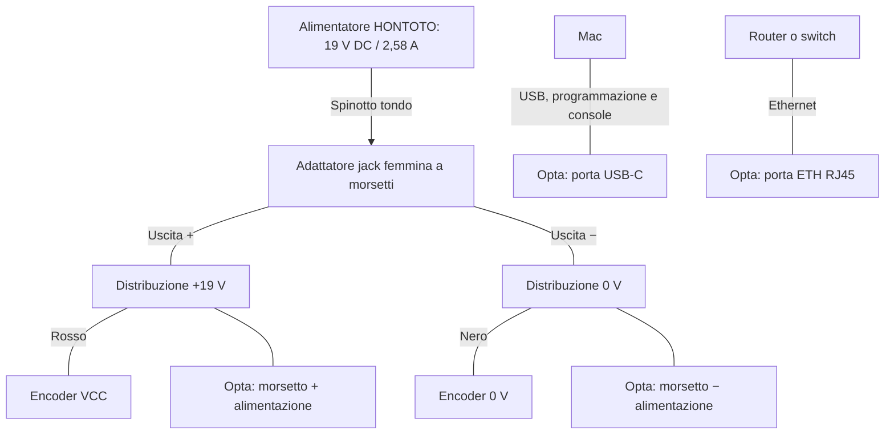

# Cablaggio da banco: Opta Lite e encoder incrementale

Schema aggiornato all'alimentatore HONTOTO ADS-65HI-19A-1 19050E,
uscita nominale 19 V DC / 2,58 A (49,02 W). L'utente riferisce 19 V misurati.
Adattatore jack a morsetti già disponibile. Nella foto il marrone è sul
morsetto marcato − e il blu sul +: questa assegnazione va confermata con
multimetro, senza ricavare la polarità dal solo colore.
Il modulo USB-C PD trigger non è necessario con questo alimentatore.
Questa revisione sostituisce il precedente schema per il Samsung da 14 V.

La parte A/B è valida **soltanto dopo aver confermato uscite
NPN open collector compatibili con pull-up a 19 V**. L'etichetta fotografata
conferma i colori ma non il circuito di uscita. Non è uno schema universale
per tutti gli encoder.

## Alimentazione e comunicazione



Il ramo verso i morsetti di alimentazione Opta rende esplicita l'alimentazione
di esercizio a 19 V. La USB dal Mac resta una connessione separata. Non applicare
19 V alla porta USB dell'Opta né a una porta USB del Mac.
Non sono previsti collegamenti ai relè di uscita.

## Primo passo pratico: sola alimentazione

1. Confermare circa +19 V con puntale rosso sul blu e nero sul marrone.
   Se il multimetro indica −19 V, le polarità sono invertite rispetto a questa
   assegnazione: identificare nuovamente positivo e negativo.
2. Staccare la spina di rete dell'alimentatore e la USB dal Mac.
3. Portare il positivo identificato a un morsetto Opta marcato + nel gruppo
   di alimentazione 12–24 V DC; portare il negativo a un morsetto marcato −.
   Non usare I1–I8, uscite relè o la vite di terra funzionale per l'alimentazione.
4. Per alimentare anche l'encoder, usare diramazioni con morsetti isolati:
   positivo → Opta + e encoder rosso; negativo → Opta − e encoder nero.
5. Lasciare bianco, verde e schermatura isolati separatamente in questo passaggio.
   La schermatura non sostituisce il nero di alimentazione.
6. Stringere i morsetti senza lasciare rame scoperto e senza trefoli liberi.
7. Ricollegare l'alimentatore alla presa. La USB può essere ricollegata per la
   console e la programmazione, dopo aver completato il cablaggio a dispositivo
   disalimentato. I dati attuali rimangono simulati, anche con l'encoder alimentato.

## Segnali: proposta condizionata a uscita NPN open collector

```text
                         +19 V comune
                           |        |
                         [R1]     [R2]
                           |        |
Encoder BIANCO (A) ---------o--------|-------- Opta I1 (A0)
                                    |
Encoder VERDE  (B) ------------------o-------- Opta I2 (A1)

Encoder NERO (0 V) --------------------------- Opta − / 0 V comune
```

Le due righe di segnale non sono collegate fra loro. R1 va da +19 V al segnale A;
R2 va da +19 V al segnale B. Le resistenze non sono in serie ai fili A/B.

Valore iniziale proposto per il solo test manuale, dopo conferma del tipo di
uscita: **R1 = R2 = 2,2 kΩ, almeno 0,5 W**. A 19 V la corrente massima
di ciascun pull-up è circa 8,6 mA e la potenza massima circa 0,164 W.
Verificare che l'encoder possa assorbire questa corrente e sostenere la tensione
del pull-up. Non applicare questo schema a uscite TTL, line driver o sin/cos.

Con l'impedenza nominale d'ingresso Opta di 8,9 kΩ, il calcolo semplificato
del livello alto con pull-up 2,2 kΩ è circa 15,2 V. È un valore di progetto,
non una misura o una garanzia; il livello va verificato sul circuito reale.
Gli ingressi saranno configurati come digitali (0–24 V), con pull-up esterni;
il circuito non è destinato alla lettura analogica 0–10 V.

La schermatura metallica non è il negativo di alimentazione: resta distinta
dal nero. Per la prima prova manuale tenerla isolata; per l'installazione
definitiva definire il collegamento a terra funzionale/telaio e le regole EMC.

## Verifica prima dell'accensione completa

1. A carichi scollegati collegare lo spinotto all'adattatore jack femmina a morsetti.
2. Misurare uscita e polarità con multimetro: circa +19 V rispetto a 0 V.
3. Eseguire i cablaggi con tutte le alimentazioni, inclusa USB, scollegate.
4. Confermare il tipo di uscita encoder prima di montare i pull-up.
5. Alimentare e controllare i segnali statici A/B, fermando l'albero in diverse
   posizioni: devono raggiungere valori bassi e alti compatibili con Opta.
   Il multimetro non verifica la qualità dei fronti alle alte velocità.
6. Per Opta il datasheet indica LOW fino a 4,46 V e HIGH da 6,6 V; durante
   il collaudo puntare a valori lontani dalle soglie, non alla loro prossimità.
7. Caricare e collaudare il firmware per encoder fisico. Il firmware attuale
   rimane un simulatore e non legge i morsetti I1/I2.

Il presente documento non stabilisce la frequenza massima del sistema:
prima dell'uso macchina servono misura della velocità, verifica segnali e
collaudo del contatore.

## Fonti

- Colori: etichetta originale fotografata dall'utente.
- Alimentatore: etichetta originale HONTOTO ADS-65HI-19A-1 19050E fotografata dall'utente.
- https://docs.arduino.cc/resources/datasheets/AFX00001-AFX00002-AFX00003-datasheet.pdf
- https://docs.arduino.cc/resources/pinouts/AFX00001-AFX00002-AFX00003-full-pinout.pdf

R1/R2 e il relativo calcolo costituiscono una proposta progettuale per il test;
non sono una prescrizione del produttore dell'encoder.
